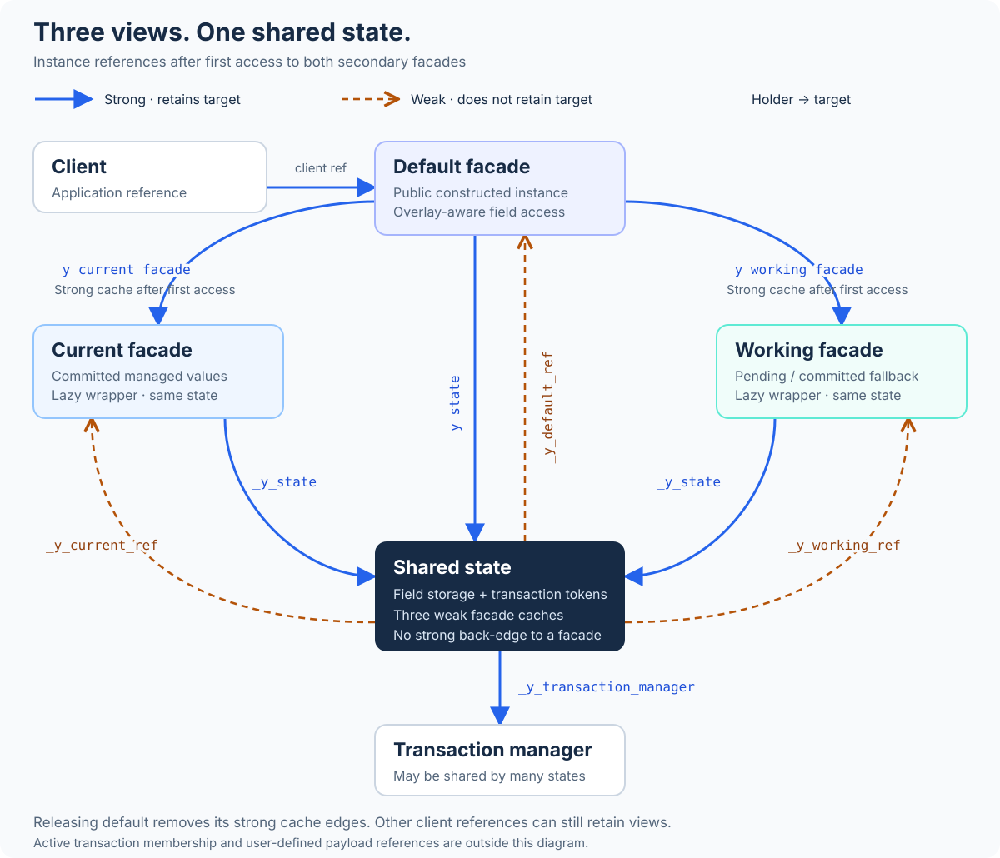

# Lifecycle facades: references and lifetime

A Lifecycle instance separates field storage from the objects used to access
it. The **default**, **current**, and **working** facades share one state object.
Each facade strongly references that state; the state caches the facades through
weak references.

There is one additional ownership edge: **the default facade strongly caches
current and working once they are requested**. They are created lazily, but
dropping a caller's reference does not collect them while that default facade
still retains them.

## Object graph

[Open the SVG separately](images/facade-ownership.svg) to enlarge or reuse it.
Arrowheads point from the object holding a reference to the referenced object.
The diagram shows both secondary facades after their first access and no active
transaction. A client can also hold any facade directly.

| Reference | Kind | Effect |
| --- | --- | --- |
| Client → any facade | Strong | Retains that facade and, through it, the state. |
| Any facade → `_y_state` | Strong | All views operate on the same field storage. |
| State → `_y_default_ref`, `_y_current_ref`, `_y_working_ref` | Weak | Reuses a surviving facade without keeping it alive. |
| Default → `_y_current_facade`, `_y_working_facade` | Strong, initially `None` | Retains the lazily created secondary facades. |
| State → `_y_transaction_manager` | Strong | Retains the manager used for edits and completion. |

## What the objects contain

The decorator generates a facade base derived from the user's class, three
facade classes, and a separate state class. The public generated class
constructs the default facade. All three facade classes inherit the common
base, including access to user methods and the `.default`, `.current`, and
`.working` properties. The state is a storage object, not a fourth view.

The state holds generated field slots, managed current/working/staged storage,
transaction tokens, the manager reference, and the weak facade caches. Generated
field properties route access through this state. The default facade chooses
the ordinary overlay-aware behavior; current reads committed managed values;
working exposes pending values with committed fallback. Plain fields use shared
nontransactional storage.

These are **live views, not copies or history frames**. Keeping a current facade
does not preserve an old committed value. For access policy and transaction
examples, see the [API guide](ManagedContextApiDraft.md#choose-a-view).

## When facades can disappear

Assume both secondary facades have been requested, and no user-defined field,
closure, or other object holds additional facade references:

| References still held by the client | Facades retained | Why |
| --- | --- | --- |
| Default only | Default, current, working | Default's two strong caches retain the secondary views. |
| Current only, after releasing default | Current | Current retains state; state's weak caches cannot retain default or working. |
| Working only, after releasing default | Working | The same rule applies in the other direction. |
| None | None from the weak caches | State alone cannot retain any facade. Other references can still retain state. |

Releasing the default removes its two strong cache edges. Any secondary facade
with no remaining strong owner then becomes eligible for collection. The weak
cache entry may still contain a `weakref.ref`, but calling it returns `None`
after its target is collected. Collection timing follows the Python runtime;
this is an ownership guarantee, not a promise of immediate destruction.

If current survives, accessing `current.default` can recreate a default facade
around the **same state**, without rerunning initialization. The new default
caches any surviving secondary facades. Accessing a missing current or working
facade similarly creates a new wrapper. Wrapper identity can therefore change
after collection, while the retained state and its field values remain shared.

An active transaction adds strong participant references to enlisted state
objects through the manager's transaction membership. A retained transaction
can also retain those participants. Field payloads and application references
may add further edges; they are outside this diagram. Facade collection does
not itself commit, roll back, or establish resource cleanup.

## Implementation reference

The ownership rules are generated by `ClassBundle` in
[`lifecycle_core.yidl`](../src/yidl_lifecycle/yidl/lifecycle_core.yidl): inspect
the state getters, facade base, and default facade slots/constructor. The
[decorator tests](../tests/test_lifecycle_decorator.py) check strong secondary
caching and weak-reference support. A cleanup probe against the
[checked-in generated fixture](../tests/data/perf/lifecycle_constructor_perf_generated.py)
also confirms retention by default, collection after default release, and
recreation around surviving state.
